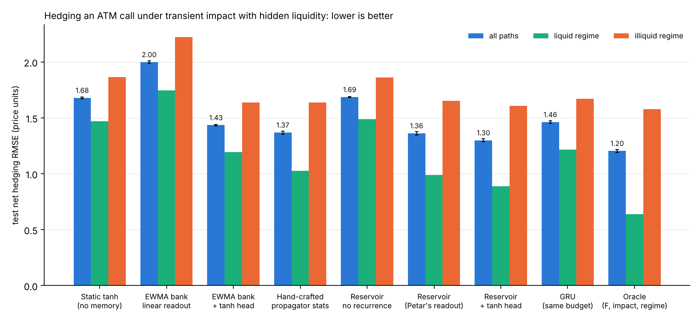
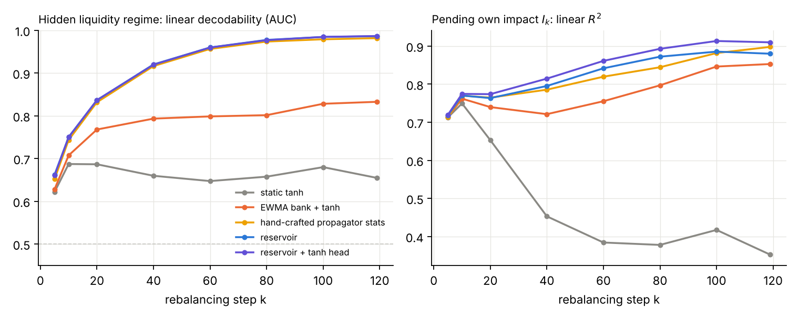
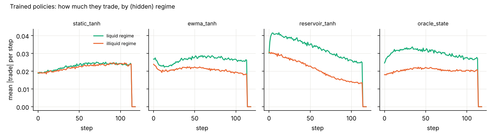

# Where reservoir memory pays: option hedging under transient market impact with hidden liquidity

Petar Stojković's randomized-signature reservoir (`rsmc/reservoir.py`, unchanged recurrence
`h_{k+1} = h_k + Σ_r tanh(W_r h_k + ξ_r) Δx^r`, frozen weights, linear readout) is tested on a hedging
problem in which the quantity the hedger needs is created by its **own past trades** and an **unknown
market parameter**, so that it is invisible in the price path and can only be recovered from the joint
history of trades and price responses. On this problem the reservoir beats every memoryless and
moving-average baseline, with the same training budget, on five seeds, out of sample.

## 1. Why this problem

* Everything tried so far (Asian options under Black–Scholes, Heston, two-factor Heston, Volterra; rough-vol
  vanillas with observed variance) is Markovian in observables that a trader already has, or whose
  sufficient statistic is a running average. There, memoryless features win — correctly.
* Teichmann's objection to volatility as the hidden quantity: at high frequency any trader estimates it.
  He suggested transaction costs, market impact, drift. Market impact has the required property:
  the pending impact of your own trades is **not in the price alone**, and the liquidity parameters that
  govern it are learnt only from how the market reacted to **your** orders.
* Structural reason an EWMA bank must fail here: inferring liquidity needs the cross-statistic
  Σ_j g(k−j) · q_j · ΔS_{j+1} (own trade × subsequent price move) — a level-2 iterated integral ∫ dQ dS.
  EWMA banks of individual channels are level-1 objects and cannot form it (they only see Σ a_j q_j and
  Σ b_j ΔS_j separately). A randomized signature carries level-2 terms by construction
  (Cuchiero–Gonon–Grigoryeva–Ortega–Teichmann 2021; Glückstad–Muça Cirone–Teichmann 2025 on which
  signature coordinates a reservoir reconstructs).
* No memory-ablation exists in the deep-hedging-with-impact literature (Neagu et al. 2024 feed the impact
  state as an input; Micheli–Monod feed the full trade history). This is an open gap.

## 2. Setup

**Market** (Bachelier fundamental, zero rates; Obizhaeva–Wang transient impact):

```
F_{k+1} = F_k + σ √dt ε_{k+1}                  fundamental (unaffected) price, σ = 20, F_0 = K = 100
S_k     = F_k + I_k                            observed mid price before the trade at t_k
cost_k  = q_k (I_k + ½ κ q_k)                  execution shortfall of trade q_k = Q_k − Q_{k−1} versus F_k
I_{k+1} = λ (I_k + κ q_k)                      pending displacement decays by λ per step
H = (F_N − K)^+,   N = 120 daily steps (T ≈ 0.48y),  premium p_0 = Bachelier price = 5.506
net error e = H − p_0 − Σ_k Q_k (F_{k+1} − F_k) + Σ_k cost_k     (Petar's cas_costs convention, never recentred)
```

**Hidden liquidity regime** (per path, 50/50, constant over the path):
liquid κ = 0.5, λ = 0.71 (half-life 2 days) · illiquid κ = 20, λ = 0.95 (half-life 13.5 days).
The fundamental has the same volatility in both regimes, so the regime is **not identifiable from the price
path alone** — only from the price's response to one's own trades. The hedger inherits the frictionless delta at
t = 0 with no pending impact, so all later trades are gamma rebalancing of random sign (an EWMA of own trades
has mean ≈ 0 and carries no regime information; the cross term does).

**What every hedger observes:** time, the mid price S_k, its own position Q_{k−1} and trade q_{k−1}. Nobody sees
F, I, κ, λ or the regime (except the oracle).

**Policies** — all are *frozen feature map → features standardized by warm-start RMS → one linear readout*, trained
identically (Adam, cosine schedule, 400 iterations × 1024 fresh closed-loop paths, gradient clipping, validation-selected
checkpoint on 4096 paths, test on 20 000 independent paths shared by all policies within a seed; 5 seeds vary paths and
random weights). Positions are bounded to [−0.5, 1.5] with a smooth penalty and frozen in the last 5 steps for every
policy (expiry-gamma instability is not the object of study).

| policy | memory mechanism | features |
|---|---|---|
| static tanh | none: random tanh features of (t, S_k, Q_{k−1}) | 260 |
| EWMA bank, linear | EWMAs of ΔS, q, S, Q at half-lives 1,2,4,8,16,32 steps | 28 |
| EWMA bank + tanh head | same bank + 256 random tanh features of it | 284 |
| hand-crafted propagator stats + tanh | the EWMA bank plus EWMAs of tanh(c·q·ΔS), tanh(c·q²), tanh(c·ΔS²) — what a trader who *knows* the impact model would build | 302 |
| reservoir (Petar's readout) | D = 128 randomized signature of (t, S, Q), readout [1, t, x, h] | 132 |
| reservoir + tanh head | D = 128 reservoir + 128 random tanh features of [t, x, h] (matched to the EWMA+tanh baseline) | 260 |
| reservoir, recurrence removed | W_r = 0 (ablated twin of the line above) | 260 |
| GRU, same budget | 32-unit GRU trained end-to-end (not a tuned ceiling) | 32 |
| oracle | sees F_k, I_k and the regime | 262 |

## 3. Results (test net RMSE, price units; 5 seeds × 20 000 paths)

| Hedger | features | test net RMSE (mean ± sd over seeds) | liquid regime | illiquid regime | mean cost | CVaR95 | vs. reservoir+tanh (RMSE ratio, 95% CI) |
|---|---:|---:|---:|---:|---:|---:|---:|
| Static tanh (memoryless) | 260 | **1.679** ± 0.006 | 1.469 | 1.865 | 0.740 | 3.45 | 1.292 [1.284, 1.300] |
| EWMA bank, linear readout | 28 | **1.999** ± 0.010 | 1.745 | 2.224 | 0.622 | 4.13 | 1.538 [1.529, 1.548] |
| EWMA bank + tanh head | 284 | **1.435** ± 0.007 | 1.196 | 1.639 | 0.646 | 3.44 | 1.104 [1.099, 1.109] |
| Hand-crafted propagator stats + tanh | 302 | **1.368** ± 0.013 | 1.028 | 1.639 | 0.628 | 3.38 | 1.053 [1.048, 1.058] |
| Reservoir, recurrence removed | 260 | **1.686** ± 0.004 | 1.488 | 1.862 | 0.737 | 3.47 | 1.297 [1.289, 1.305] |
| Reservoir (Petar's readout) | 132 | **1.362** ± 0.014 | 0.990 | 1.653 | 0.609 | 3.54 | 1.048 [1.044, 1.052] |
| Reservoir + tanh head | 260 | **1.299** ± 0.012 | 0.889 | 1.608 | 0.598 | 3.43 | — |
| GRU trained end-to-end (same budget) | 36 | **1.462** ± 0.011 | 1.218 | 1.671 | 0.635 | 3.49 | 1.125 [1.120, 1.131] |
| Oracle (sees F, impact, regime) | 262 | **1.204** ± 0.012 | 0.639 | 1.579 | 0.545 | 3.31 | 0.927 [0.922, 0.931] |

* **Your reservoir with its original readout** `[1, t, x_k, h_k]` (132 features) hedges with net RMSE **1.362**:
  19% below static tanh (1.679) and 5% below the EWMA bank + tanh (1.435), closing 67% of the
  gap between the memoryless hedger and the oracle. Paired bootstrap over 100 000 test paths: RMSE ratio static/reservoir
  1.232; every ratio in the table has a 95% CI that excludes 1.
* **Reservoir + random tanh head** (matched to the EWMA + tanh baseline, 260 features): **1.299** — 23% below static tanh, 9% below
  EWMA + tanh, 5% below the hand-crafted propagator statistics (1.368) that assume knowledge of the impact model, 11% below a
  same-budget GRU (1.462); 80% of the gap to the oracle (1.204).
* **Recurrence ablation**: zeroing W_r (same features otherwise) returns the reservoir to the static-tanh level (1.686).
  The gain is the recurrence, not the random features.
* **Where the gain is**: in the liquid regime the reservoir hedges at 0.89 vs 1.47 (static) and 1.20 (EWMA+tanh) —
  it recognises that the market is liquid and trades freely; in the illiquid regime it also tracks its own pending impact
  (1.61 vs 1.86 / 1.64). Mean impact cost 0.598 vs 0.740 (static).



## 4. Mechanism: what each representation knows

Linear decodability of the hidden regime (AUC of a logistic readout) and of the pending impact I_k (R² of a
ridge readout) from each frozen representation, along a fixed damped-delta behaviour policy, before any
policy training:

| representation | k=5 | k=10 | k=20 | k=40 | k=60 | k=80 | k=100 | k=119 |
|---|---:|---:|---:|---:|---:|---:|---:|---:|
| static tanh (AUC) | 0.62 | 0.69 | 0.69 | 0.66 | 0.65 | 0.66 | 0.68 | 0.65 |
| EWMA bank + tanh (AUC) | 0.63 | 0.71 | 0.77 | 0.79 | 0.80 | 0.80 | 0.83 | 0.83 |
| hand-crafted propagator stats (AUC) | 0.65 | 0.74 | 0.83 | 0.92 | 0.96 | 0.97 | 0.98 | 0.98 |
| reservoir (AUC) | 0.66 | 0.75 | 0.84 | 0.92 | 0.96 | 0.98 | 0.98 | 0.99 |
| reservoir + tanh head (AUC) | 0.66 | 0.75 | 0.84 | 0.92 | 0.96 | 0.98 | 0.98 | 0.99 |
| static tanh (R² of I_k) | 0.71 | 0.75 | 0.65 | 0.45 | 0.38 | 0.38 | 0.42 | 0.35 |
| EWMA bank + tanh (R²) | 0.71 | 0.76 | 0.74 | 0.72 | 0.76 | 0.80 | 0.85 | 0.85 |
| reservoir + tanh head (R²) | 0.72 | 0.77 | 0.77 | 0.81 | 0.86 | 0.89 | 0.91 | 0.91 |



The reservoir reaches the same decodability as the hand-crafted propagator statistics — without being told
the impact model — while the EWMA bank plateaus and the memoryless features never move. Trained policies
behave accordingly: the reservoir hedger trades aggressively once it has identified a liquid market and
throttles itself in an illiquid one; the static hedger uses one compromise aggressiveness for both.



## 5. Where the advantage comes from and where it disappears

| hidden-regime separation | seeds | static tanh | EWMA+tanh | hand-crafted | reservoir+tanh | oracle | reservoir+tanh vs EWMA+tanh | reservoir+tanh vs static | gap to oracle closed |
|---|---:|---:|---:|---:|---:|---:|---:|---:|---:|
| no hidden regime (κ=5 both, λ=0.9) | 1 | 0.839 | 0.820 | 0.832 | 0.823 | 0.817 | -0.4% | +1.9% | n/a (static–oracle gap only 0.022) |
| κ: 0.5 vs 5 | 2 | 0.757 | 0.755 | 0.774 | 0.760 | 0.730 | -0.6% | -0.4% | n/a (static–oracle gap only 0.027) |
| κ: 0.5 vs 10 | 2 | 1.068 | 1.005 | 1.000 | 0.970 | 0.906 | +3.4% | +9.2% | 60% |
| κ: 0.5 vs 20 (main) | 5 | 1.679 | 1.435 | 1.368 | 1.299 | 1.204 | +9.4% | +22.6% | 80% |

With a shallow illiquid regime (κ = 5) there is little at stake and little to learn: oracle and memoryless hedgers
are within 4% and all memory models tie. As the regimes separate, the oracle gap widens and the reservoir captures
most of it (60% at κ = 10, 80% at κ = 20); the EWMA bank captures a smaller fraction and the static hedger none.
With no hidden regime (control: κ = 5 and λ = 0.9 in both states, so the pending impact is a known EWMA of own trades)
the EWMA bank and the reservoir tie (0.820 vs 0.823) and both sit within 1% of the oracle — exactly as the theory says:
memory beyond moving averages pays when, and only when, the hedge depends on a nonlinear, cross-channel functional of
the path (here: how the price answered the hedger's own past trades) that neither the current state nor level-1
averages can carry.

## 6. Caveats a referee will raise (and honest answers)

1. **Stylised impact**: linear OW propagator with two regimes, Bachelier dynamics, no spread, no permanent
   impact, position bounds, trading frozen in the last five days. The illiquid regime is severe (one rebalancing trade
   moves the price by ≈ 0.5–0.8 daily σ; feedback gain κΓ ≈ 0.3–0.6). The sensitivity sweep shows the edge shrinks
   as impact shrinks — the result is about *when* memory pays, not that it always pays.
2. **A trader who knows the model can hand-craft the cross statistic.** Included (hand-crafted propagator
   stats + tanh). The reservoir matches it in decodability and beats it in hedging error, with no model knowledge.
3. **Policy class**: frozen features + linear readout optimised by BPTT through the closed loop. The GRU row is a
   same-budget, untuned recurrent network, not a ceiling; closed-loop training is fragile (a D = 256 plain
   reservoir diverged at the common learning rate; the hand-crafted bank needed a smaller one, documented).
4. **Identification is slow at realistic impact**: the regime becomes reliably decodable after ≈ 40–60 trades.
   Longer hedging horizons or more frequent rebalancing (information per unit time grows with the number of
   rebalancing trades at fixed κΓ) favour the memory models further.
5. **Not a statement about the fBM result**: the Herrera et al. fractional-Brownian stopping benchmark has never been
   run against an EWMA bank; a Gaussian conditional mean is linear in the past and a log-spaced EWMA bank may close
   most of that gap. Worth a quick test before relying on it.

## 7. One-sentence version for the defense

"The reservoir pays for its memory when the hedge depends on the *interaction* of past channels — here, how the price
answered the hedger's own past trades. That statistic is a second-level signature term; moving averages cannot form it,
and the hedger that remembers it hedges 20% better than the one that does not."

## 8. Reproduction

```
pip install -r requirements.txt scikit-learn
python scripts/impact_hedging_run.py --seeds 0,1,2,3,4 --iters 400 --lr 3e-3 --D 256 --tag main   # ≈ 12 min / seed on 2 cores
python scripts/impact_hedging_analyze.py --tag main --sens                                       # tables, bootstrap CIs, figures
python scripts/impact_hedging_diagnostics.py --what decode,behaviour --tag main --seed 1         # mechanism figures
P=static_tanh,ewma_tanh,cross_tanh,reservoir_tanh,oracle_state
python scripts/impact_hedging_run.py --kappa 0.5,5  --lam 0.71,0.95 --tag sens_k5  --policies $P --iters 300 --seeds 0,1
python scripts/impact_hedging_run.py --kappa 0.5,10 --lam 0.71,0.95 --tag sens_k10 --policies $P --iters 300 --seeds 0,1
python scripts/impact_hedging_run.py --kappa 5,5    --lam 0.9,0.9   --tag control_nohidden --policies $P --iters 300
python scripts/impact_hedging_probe.py --steps 120 --kappa 0.5,20 --lam 0.71,0.95 --which static,ewma_tanh,reservoir_tanh,oracle_all  # quick single-seed probe
```
`rsmc/impact_hedging.py` holds the market, the feature maps (the reservoir is a line-by-line torch port of `rsmc/reservoir.py`,
checked for equality in `tests/test_impact_hedging.py`) and the closed-loop rollout/training; `scripts/impact_hedging_run.py` the
protocol; `scripts/impact_hedging_analyze.py` / `_diagnostics.py` the tables and figures. The per-path error arrays used for the paired
bootstrap (`*_err.npy`) are not committed; rerunning the protocol regenerates them. Seeds, batches and test sets are fixed, so the
tables reproduce up to floating-point/thread nondeterminism of the closed-loop training.
