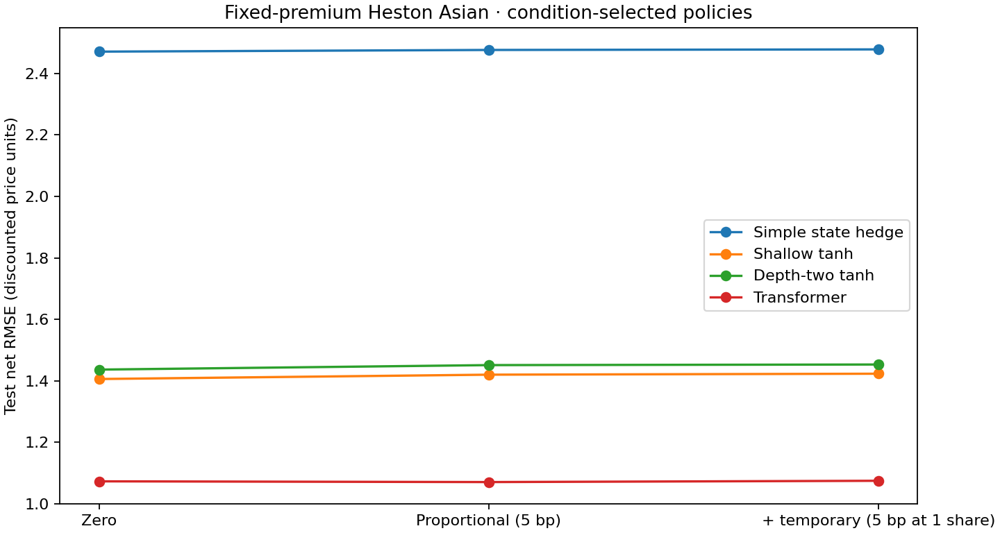

# Cost-aware Heston Asian reference

Completed 220 counted fits (cap 256), all 36 declared evaluations; 0 failures.
Fixed premium: 5.273878097534. Costs are illustrative and uncalibrated; see plan.json and README methods.

| Condition | Method | Configuration source | Net RMSE (units) | Mean error (units) | Turnover (shares) | Costs (discounted units) |
|---|---|---|---:|---:|---:|---:|
| zero | simple | baseline | 2.471105 | +0.045524 | 1.307678 | 0.000000 |
| zero | shallow | cost_selected | 1.405672 | +0.041689 | 1.935748 | 0.000000 |
| zero | depth_two | cost_selected | 1.436310 | +0.043316 | 1.891566 | 0.000000 |
| zero | transformer | baseline | 1.072715 | +0.038839 | 1.987161 | 0.000000 |
| proportional | simple | baseline | 2.476555 | +0.109712 | 1.311061 | 0.064185 |
| proportional | shallow | frictionless_selected | 1.419795 | +0.138228 | 1.933947 | 0.096727 |
| proportional | shallow | cost_selected | 1.419795 | +0.138228 | 1.933947 | 0.096727 |
| proportional | depth_two | frictionless_selected | 1.450942 | +0.137220 | 1.883739 | 0.094235 |
| proportional | depth_two | cost_selected | 1.450942 | +0.137220 | 1.883739 | 0.094235 |
| proportional | transformer | baseline | 1.070317 | +0.136261 | 1.960842 | 0.098453 |
| combined | simple | baseline | 2.478381 | +0.124810 | 1.310062 | 0.079286 |
| combined | shallow | frictionless_selected | 1.422917 | +0.156672 | 1.933520 | 0.115196 |
| combined | shallow | cost_selected | 1.422917 | +0.156672 | 1.933520 | 0.115196 |
| combined | depth_two | frictionless_selected | 1.452884 | +0.155736 | 1.887437 | 0.112560 |
| combined | depth_two | cost_selected | 1.452884 | +0.155736 | 1.887437 | 0.112560 |
| combined | transformer | baseline | 1.074479 | +0.154423 | 1.955990 | 0.116638 |

Both reference configurations are retrained under the row's cost condition. Identical selected tuples reuse the same fits explicitly (see aliased_comparisons in results.json).

Validation-selected reservoir reference configurations:
- zero, shallow: tuple 3 {'architecture': 'shallow', 'dim': 32, 'weight_scale': 1.0, 'bias_scale': 1.0, 'lam': 0.1}; validation net MSE 1.885936.
- zero, depth_two: tuple 9 {'architecture': 'depth_two', 'dim': 32, 'weight_scale': 1.0, 'bias_scale': 1.0, 'lam': 0.1}; validation net MSE 1.865754.
- proportional, shallow: tuple 3 {'architecture': 'shallow', 'dim': 32, 'weight_scale': 1.0, 'bias_scale': 1.0, 'lam': 0.1}; validation net MSE 1.907257.
- proportional, depth_two: tuple 9 {'architecture': 'depth_two', 'dim': 32, 'weight_scale': 1.0, 'bias_scale': 1.0, 'lam': 0.1}; validation net MSE 1.887597.
- combined, shallow: tuple 3 {'architecture': 'shallow', 'dim': 32, 'weight_scale': 1.0, 'bias_scale': 1.0, 'lam': 0.1}; validation net MSE 1.913264.
- combined, depth_two: tuple 9 {'architecture': 'depth_two', 'dim': 32, 'weight_scale': 1.0, 'bias_scale': 1.0, 'lam': 0.1}; validation net MSE 1.893342.

Optimizer outcomes: {'exact_ridge': 43, 'budget_exhausted': 176, 'stationary': 1}. A step/epoch limit is not convergence or a failure. Norms characterize final iterates, while retained checkpoints minimize validation net MSE.
Measured wall time: data 0.052s; feature groups 17.145s; fit totals by phase {'tuning': 364.97350172500046, 'fresh': 40.93734230599512, 'baseline': 270.7522625299989}; evaluation and artifact saving 5.930s. Per-fit setup, optimization, validation and convergence-check times are saved in results.json; initial ridge solves and all restarts are counted.



The overall validation-selected reservoir reference is depth-two, D=32, matrix/bias scales 1 and lambda 0.1 in every condition (saved in `reference_configuration`). Both within-architecture selections remain identical to zero cost. Shallow has slightly lower fresh-draw test RMSE; this observation does not revise the validation-selected reference. The Transformer has the lowest test net RMSE among these tested policies. Its small proportional-versus-zero difference is not evidence that charges improve optimal hedging: positive-cost validation selected seed 51002, whereas the zero run used seed 51001.

The complete invocation took 736.185 seconds, including bookkeeping and report generation. All 86 tests passed; the artifact audit in validation.txt independently verified the 36 saved cash-flow records, selection rules, source hashes and zero-cost ridge agreement.

Conclusions concern these implemented policy classes under the fixed budget, not globally optimal hedging. Net-error training with costs is generally nonconvex, despite convex execution charges. One dataset partition, three reservoir draws, a sparse shortlist, limited restarts, uncalibrated coefficients and different readout coordinates limit comparisons. No position feedback, new information, price impact, filtering or new architecture was introduced.

Run/resume from repository root:
```bash
OMP_NUM_THREADS=2 OPENBLAS_NUM_THREADS=2 MKL_NUM_THREADS=2 MPLCONFIGDIR=/workspace/.cache/rsmc-matplotlib XDG_CACHE_HOME=/workspace/.cache /workspace/.venvs/rsmc/bin/python scripts/cas_costs.py
```
