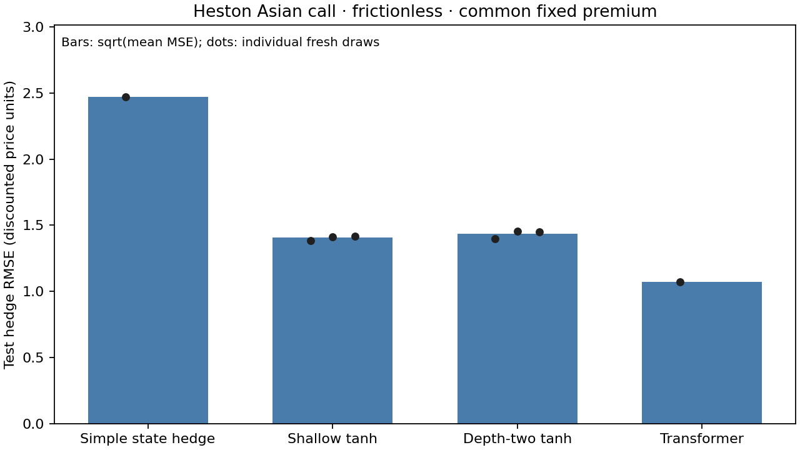

# Bounded frictionless Heston comparison

Status: completed; fit attempts: 44/44; failures: 0.
Frozen premium: 5.273878098; training estimate SE: 0.102559.

| Method | Fresh draws | Test MSE (units²) | RMSE (units) | Mean error (units) | Tuning (s) | Final features / fit / evaluation (s) |
|---|---:|---:|---:|---:|---:|---|
| Simple state hedge | 1 | 6.106359 | 2.471105 | +0.045524 | 0.00 | 0.01 / 0.00 / 0.00 |
| Shallow tanh | 3 | 1.975913 | 1.405672 | +0.041689 | 6.95 | 3.35 / 0.02 / 0.00 |
| Depth-two tanh | 3 | 2.062985 | 1.436310 | +0.043316 | 8.63 | 2.21 / 0.02 / 0.00 |
| Transformer | 1 | 1.150670 | 1.072693 | +0.038839 | 0.00 | 0.00 / 52.29 / 2.50 |

Times are totals over the listed draws, not per-fit averages. Shared simulation/state features are recorded separately in results.json. Transformer input preprocessing and epoch selection are included in its fit time; evaluation includes input transformation.

Selected configurations:
- shallow: {'architecture': 'shallow', 'dim': 32, 'weight_scale': 1.0, 'bias_scale': 1.0, 'lam': 0.1}; three-draw mean validation MSE 1.885936.
- depth_two: {'architecture': 'depth_two', 'dim': 32, 'weight_scale': 1.0, 'bias_scale': 1.0, 'lam': 0.1}; three-draw mean validation MSE 1.865754.



One dataset partition, three validation and three fresh reservoir draws per architecture; one Transformer seed. Sparse non-factorial candidates; equal state/readout width but depth-two has more frozen parameters and computation. No transaction/execution costs, transfer study, hidden variance inputs, synthetic signals or filtering. The finite-sample premium is frozen, so mean error is retained. No significance or universal architecture-ranking claim follows from this run.

Declaration: plan.json. Every fit, failure, seed, coefficient, metric and timing: results.json. Test residual arrays and the Transformer state are retained alongside this report.

Run/resume from the repository root:
```bash
OMP_NUM_THREADS=2 OPENBLAS_NUM_THREADS=2 MKL_NUM_THREADS=2 MPLCONFIGDIR=/workspace/.cache/rsmc-matplotlib /workspace/.venvs/rsmc/bin/python scripts/cas_frictionless.py
```
