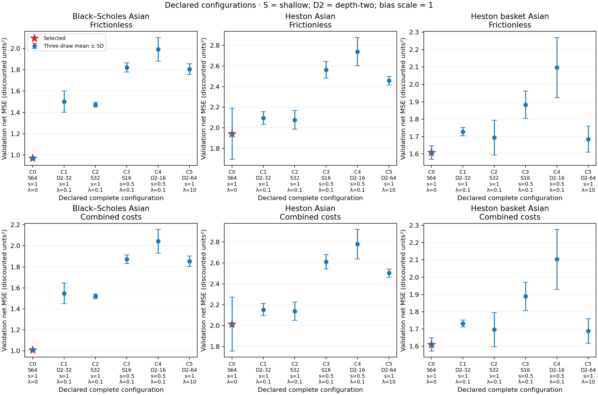
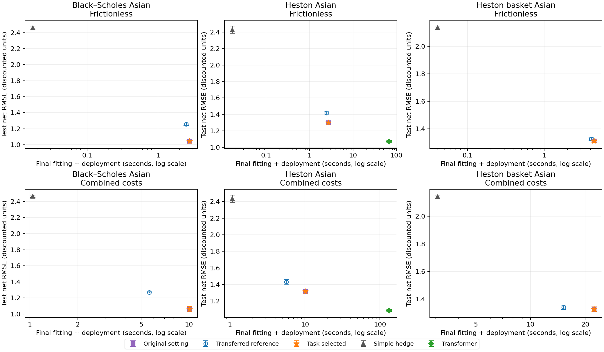
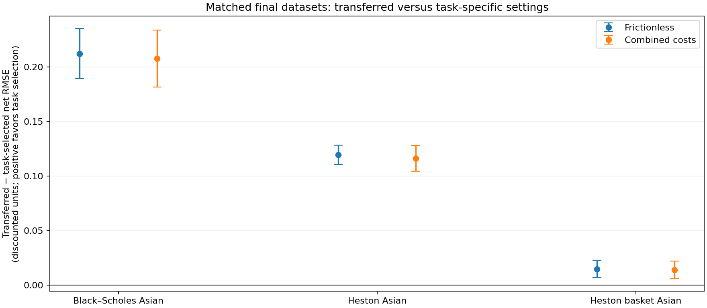

# Final CAS transfer and reliability study

Completed **360 counted fits** (cap 468), **132 unique final evaluations**, and **0 failures**. Identical settings share evaluation records and list all roles explicitly. The saved-run aggregation audit passed.

The study uses the existing Black–Scholes Asian, one-asset Heston Asian and three-asset Heston basket Asian tasks. Only frictionless and the validated combined-cost condition are run. All gains use discounted traded-price increments, with opening trades, rebalancing and terminal liquidation. The combined condition uses illustrative, uncalibrated kappa=eta=0.0005 and reference quantity 1 share per asset. Execution charges do not alter simulated prices.

One independent selection partition per task selects settings, using six complete tuples and three validation reservoir draws. All task selections are frozen before generating any final dataset. Final evidence uses three fresh independent dataset partitions per task and three fresh reservoir draws per selected setting. Each partition has 4,000 training, 2,000 validation and 8,000 test paths, with 50 intervals. Each partition's float32-rounded discounted training payoff mean is frozen as its common premium across methods and costs. Readouts, preprocessing and dimension-compatible frozen matrices are refitted/redrawn on the target; only the tuple transfers.

The original setting is the README quick-start tuple (shallow D=64, matrix/bias scales 1, lambda=0), adapted to this study's traded-gain and fixed-premium convention. The historical example was a pricing control; its fitted coefficients and historical performance are not hedge evidence. The transferred reference is the saved validation-selected depth-two D=32, scales 1, lambda=0.1 under the same cost condition. Transformer comparisons remain restricted to the predeclared Heston reference; its architecture is unchanged, with one frictionless and two combined-cost starts per final partition. The simple hedge is retained everywhere.

## Declaration and selections

| ID | Architecture | D | Matrix scale | Bias scale | Lambda |
|---|---|---:|---:|---:|---:|
| C0 | shallow | 64 | 1.0 | 1.0 | 0.0 |
| C1 | depth_two | 32 | 1.0 | 1.0 | 0.1 |
| C2 | shallow | 32 | 1.0 | 1.0 | 0.1 |
| C3 | shallow | 16 | 0.5 | 1.0 | 0.1 |
| C4 | depth_two | 16 | 0.5 | 1.0 | 0.1 |
| C5 | depth_two | 64 | 1.0 | 1.0 | 10.0 |

Selection minimizes unpenalized validation net MSE, first across checkpoints and the two declared positive-cost starts, then averaged over the three reservoir draws. The first tuple breaks exact ties. Zero-cost fits use fixed-premium ridge; positive-cost fits use the existing 120-step optimizer and two-start budget. All reservoir matrices remain frozen. The six-tuple list was not expanded after outcomes.

| Task | Cost condition | Task-selected tuple | Validation net MSE (units²) |
|---|---|---:|---:|
| Black–Scholes Asian | Frictionless | C0 | 0.969913 |
| Black–Scholes Asian | Combined costs | C0 | 1.008536 |
| Heston Asian | Frictionless | C0 | 1.942196 |
| Heston Asian | Combined costs | C0 | 2.013744 |
| Heston basket Asian | Frictionless | C0 | 1.608129 |
| Heston basket Asian | Combined costs | C0 | 1.610850 |

## Final results

| Task | Condition | Setting | Net RMSE (units) | Dataset SD | Mean error (units) | Turnover (shares) | Costs (discounted units) |
|---|---|---|---:|---:|---:|---:|---:|
| Black–Scholes Asian | Frictionless | Original setting | 1.043560 | 0.016935 | +0.036936 | 2.160529 | 0.000000 |
| Black–Scholes Asian | Frictionless | Transferred reference | 1.255912 | 0.015982 | +0.036134 | 2.054009 | 0.000000 |
| Black–Scholes Asian | Frictionless | Task selected | 1.043560 | 0.016935 | +0.036936 | 2.160529 | 0.000000 |
| Black–Scholes Asian | Frictionless | Simple hedge | 2.458607 | 0.022370 | +0.023754 | 1.597528 | 0.000000 |
| Black–Scholes Asian | Combined costs | Original setting | 1.062299 | 0.031541 | +0.166515 | 2.167151 | 0.129629 |
| Black–Scholes Asian | Combined costs | Transferred reference | 1.269934 | 0.005705 | +0.159611 | 2.041307 | 0.122925 |
| Black–Scholes Asian | Combined costs | Task selected | 1.062299 | 0.031541 | +0.166515 | 2.167151 | 0.129629 |
| Black–Scholes Asian | Combined costs | Simple hedge | 2.464159 | 0.014328 | +0.122399 | 1.598255 | 0.098803 |
| Heston Asian | Frictionless | Original setting | 1.297897 | 0.016684 | +0.004286 | 2.019566 | 0.000000 |
| Heston Asian | Frictionless | Transferred reference | 1.417454 | 0.023769 | +0.013142 | 1.894059 | 0.000000 |
| Heston Asian | Frictionless | Task selected | 1.297897 | 0.016684 | +0.004286 | 2.019566 | 0.000000 |
| Heston Asian | Frictionless | Simple hedge | 2.428847 | 0.043811 | +0.021884 | 1.347375 | 0.000000 |
| Heston Asian | Frictionless | Transformer | 1.071211 | 0.012879 | +0.000283 | 2.038872 | 0.000000 |
| Heston Asian | Combined costs | Original setting | 1.314413 | 0.025535 | +0.123656 | 2.017647 | 0.120166 |
| Heston Asian | Combined costs | Transferred reference | 1.430741 | 0.027782 | +0.126249 | 1.897674 | 0.113241 |
| Heston Asian | Combined costs | Task selected | 1.314413 | 0.025535 | +0.123656 | 2.017647 | 0.120166 |
| Heston Asian | Combined costs | Simple hedge | 2.435305 | 0.043374 | +0.103078 | 1.344891 | 0.081174 |
| Heston Asian | Combined costs | Transformer | 1.085698 | 0.012382 | +0.121609 | 2.005295 | 0.119836 |
| Heston basket Asian | Frictionless | Original setting | 1.311087 | 0.012502 | +0.017226 | 2.120691 | 0.000000 |
| Heston basket Asian | Frictionless | Transferred reference | 1.326023 | 0.010836 | +0.013692 | 2.026289 | 0.000000 |
| Heston basket Asian | Frictionless | Task selected | 1.311087 | 0.012502 | +0.017226 | 2.120691 | 0.000000 |
| Heston basket Asian | Frictionless | Simple hedge | 2.138150 | 0.010301 | +0.002274 | 1.443336 | 0.000000 |
| Heston basket Asian | Combined costs | Original setting | 1.325760 | 0.017525 | +0.129154 | 2.115812 | 0.112035 |
| Heston basket Asian | Combined costs | Transferred reference | 1.339891 | 0.015671 | +0.121617 | 2.021514 | 0.107440 |
| Heston basket Asian | Combined costs | Task selected | 1.325760 | 0.017525 | +0.129154 | 2.115812 | 0.112035 |
| Heston basket Asian | Combined costs | Simple hedge | 2.143440 | 0.010917 | +0.078735 | 1.436995 | 0.076386 |

RMSE is the square root of mean unpenalized MSE across the three draws and three datasets. Errors are never recentered. The three draws within a dataset share its training, validation and test paths, premium and deterministic preprocessing. The same three final reservoir seeds are reused across final datasets, so dataset error bars describe dataset variation conditional on this fixed three-draw ensemble, not independent resampling of all sources of randomness. Methods and cost conditions are also matched on these paths. Consequently, nine reservoir evaluations are not nine independent dataset replicates. Dataset SD first pools the three draw MSEs within each dataset, takes its RMSE, then reports the sample SD across the three dataset RMSEs. Transformer seeds change by the declared +100 offset between final partitions, so its dataset SD also includes the declared neural initialization/training variation; the fixed-ensemble interpretation applies to reservoir rows. These are descriptive error bars, not confidence intervals; three datasets give limited reliability evidence.

| Task | Condition | Paired reference − task RMSE (units) | Dataset difference SD |
|---|---|---:|---:|
| Black–Scholes Asian | Frictionless | +0.212376 | 0.023008 |
| Black–Scholes Asian | Combined costs | +0.207939 | 0.026040 |
| Heston Asian | Frictionless | +0.119495 | 0.008831 |
| Heston Asian | Combined costs | +0.116314 | 0.011886 |
| Heston basket Asian | Frictionless | +0.014946 | 0.008016 |
| Heston basket Asian | Combined costs | +0.014147 | 0.008018 |

Positive paired differences favor task selection. Each difference uses matched final datasets after pooling their reservoir draws. Exact zeros can reflect deduplicated identical settings. Test outcomes never revise a selected setting.

## Interpretation

Every task and cost condition selected C0, the documented original setting. Original and task-selected rows therefore alias the same retrained readouts and final evaluations; they are not separate replications. In this shortlist, task selection retained the original hyperparameters rather than the transferred reference.

The task-selected setting had lower pooled final test RMSE than the transferred reference in 6 of 6 task/condition cells. This is a configuration-level observation on these datasets: architecture, width and regularization differ jointly, so it does not isolate an architecture advantage or establish that target tuning universally improves hedging.

On the retained Heston reference comparisons, the Transformer achieved the lowest pooled test RMSE with greater final fitting expense. Mean standalone training and validation-selection time was 66.25–130.67 s across the two cost conditions, compared with 1.16–8.53 s for the task-selected reservoir. The combined-cost figures include both declared starts; all timing comparisons remain descriptive.

## Computation, caching and memory

Actual unique-fit wall time: tuning 357.723 s; final fitting 1058.423 s. Feature-generation wall time: tuning 63.381 s; final 168.201 s. Final cash-flow/inference evaluation 11.416 s; array saving 2.097 s. Data generation totals 1.173 s. Invocation wall times are recorded separately in results.json, including orchestration and checkpoint writing but excluding subsequent audit/render. reporting_timings.json records the report audit, aggregation, table and figure rendering times separately.

Per-run training_s is the standalone cost of drawing that frozen reservoir, generating training/validation features, and all readout fits required for its condition, including ridge initialization and both positive-cost starts. Deployment_s is test feature generation plus position inference and cash-flow evaluation. These standalone comparison timings can reuse a shared initializer or cached features across conditions; do not sum them to infer actual total runtime. The totals above count each fit and feature group once. Tuning expense remains separate from final fitting and deployment. Timing includes validation checkpoint selection and neural checkpoint serialization; final NPZ artifact saving is reported separately. Hardware, runtime variation and differing numbers of optimizer starts limit timing comparisons.

Training/validation reservoir features are cached in memory for one configuration and draw, shared by frictionless and combined-cost readout fits and both restarts, then discarded. No persistent feature cache is used. Test features are generated only for retained comparisons. Completed fit/evaluation records are reused on resume; deterministic data and feature regeneration may incur extra costs recorded by the invocation. Per-run feature-group identifiers expose the sharing, and feature times repeated in per_run.csv must not be added repeatedly.

Measured process high-water resident memory: 1130.06 MiB. Largest recorded feature group (sum of cached feature-array nbytes): 381.32 MiB. Process RSS comes from /proc and cumulative ru_maxrss; it includes interpreter, libraries, optimizer buffers and allocator retention and is not an isolated per-model peak. Array nbytes measures the named feature arrays only and excludes temporary arrays. Measurements are descriptive of this execution environment.

Optimizer outcomes: {'exact_ridge': 117, 'budget_exhausted': 242, 'stationary': 1}. A budget-exhausted status is not numerical convergence; selecting a checkpoint does not prove stationarity. Recorded failure fields remain distinct from these optimizer-limit outcomes.

## Figures



Figure 1. Mean unpenalized validation net MSE with ± one sample SD across three reservoir draws on the task's single selection dataset. S denotes shallow, D2 depth-two, s the matrix scale and λ the readout penalty; bias scale is 1 throughout. Stars mark the frozen choices; bars describe reservoir randomness conditional on that dataset, not dataset uncertainty.



Figure 2. Pooled final net RMSE versus mean standalone final fitting plus deployment wall time, excluding tuning; the horizontal axis is logarithmic seconds. Vertical bars show ± one SD across three dataset-level RMSEs. Exact aliases overlap. No hardware-normalized or asymptotic speed claim is made.



Figure 3. Mean matched-dataset reference-minus-task-selected RMSE, with ± one sample SD of the three dataset differences. Positive values favor task selection; identical transferred and target tuples are explicitly shared.

## Reproducibility and limits

per_run.csv is the consistent table of every counted fit, including all tuning candidates, initializers, optimizer restarts, configuration JSON, dataset/reservoir or neural seeds, premium, convergence status, failures, timing and linked final errors/turnover/costs. Unselected starts have blank test columns because they were not evaluated. results.json retains checkpoints, selection scores, coefficients, hashes and memory records; per-evaluation NPZ files retain payoff, error and cash flows. summary.csv, dataset_summary.csv and paired_transfer.csv contain the derived aggregates. aggregation_audit.json records independent recomputation of every saved metric, validation selection and expected role/dataset/draw counts.

Conclusions concern the implemented policy classes and these fixed budgets, not globally optimal hedging. The shortlist is sparse; architecture, width and regularization vary jointly between configurations (including C0 versus C1), so these comparisons do not isolate an architecture effect. Positive-cost objectives are generally nonconvex, execution coefficients are uncalibrated, and only three independent final dataset partitions are available. Target selection uses one independent partition per task, so selection uncertainty itself is not repeated across final datasets. Conditional reservoir-draw variation and dataset variation remain distinct. The Heston simulator retains its existing discretization. Historical filtering experiments and separate reconstruction mathematics remain outside this study.

Run/resume from the repository root:
```bash
OMP_NUM_THREADS=2 OPENBLAS_NUM_THREADS=2 MKL_NUM_THREADS=2 MPLBACKEND=Agg MPLCONFIGDIR=/workspace/.cache/rsmc-matplotlib XDG_CACHE_HOME=/workspace/.cache /workspace/.venvs/rsmc/bin/python scripts/cas_transfer.py
```
