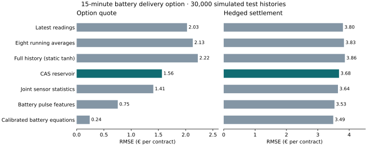

# Pricing and hedging a battery delivery option

The contract pays the positive part of the electricity settlement price above €80/MWh, multiplied by the energy a 2 MWh battery could supply at 4 MW for up to 15 minutes. The trader sees the matching forward price and 48 minutes of charge, current, voltage and temperature readings. All methods use the same simulated histories. Resistance and diffusion vary between histories and stay fixed within each one.

## Results on 30,000 simulated test histories

Each entry is a root mean squared error (RMSE). Quote error is measured against the model value with true available energy. For hedging, every method receives the same opening premium and can take one position in the electricity forward.

| Inputs or method | Deliverable energy (MWh) | Option quote (€) | Hedged settlement (€) |
|---|---:|---:|---:|
| Latest readings, static tanh | 0.175 | 2.025 | 3.801 |
| Eight exponential running averages per channel | 0.184 | 2.131 | 3.833 |
| Flattened sensor history, static tanh | 0.192 | 2.223 | 3.863 |
| **CAS randomized-signature reservoir** | **0.134** | **1.565** | **3.676** |
| Joint sensor statistics | 0.121 | 1.407 | 3.642 |
| Battery pulse features | 0.064 | 0.754 | 3.532 |
| Known battery equations calibrated to observed readings | 0.020 | 0.239 | 3.492 |
| Reference with true available energy | 0.000 | 0.000 | 3.488 |

The reservoir reduced quote RMSE by 26.6% and hedging RMSE by 4.1% compared with the eight running averages. It won that comparison on each of three splits. The latest-readings and flattened-history tanh models also had larger errors. Recording how the sensors moved together gave lower errors than the reservoir. A model that estimates apparent resistance from voltage responses to changes in current did better still.

The randomized methods use the same 32 current-reading features, plus 32 features specific to each method. Each of three splits used 6,000 training, 2,500 validation and 10,000 test histories. Validation selected the feature gain and ridge penalty across two draws. Flattened histories, joint sensor statistics and the calibrated equations were supplemental comparisons on the same test paths.

## Confirmation on 24,000 new test histories

After inspecting the first results, we fixed a second experiment using new physical paths, forward prices and feature seeds. The standalone reservoir again beat the running averages, with quote RMSE of €1.57 against €2.12 and hedge RMSE of €3.76 against €3.91. A second comparison gave a common model based on joint sensor statistics 32 extra features and let validation retain the original model.

| Features added to joint sensor statistics | Option quote RMSE (€) | Hedged settlement RMSE (€) |
|---|---:|---:|
| None | 1.431 | 3.732 |
| Latest readings, static tanh | 1.334 | 3.712 |
| Reservoir state | 1.266 | 3.700 |
| More nonlinear functions of the same joint statistics | 1.095 | 3.671 |

Adding recurrent features helped on all three new splits. Spending the same feature budget on sensor statistics improved the hedge more on each split. The per-split and pooled results are available in [metrics.csv](results/metrics.csv).

## Interpretation

The result applies to a demanding discharge on a short-duration installation. Average delivery was 0.237 MWh and 2.53% of histories supplied the full 1 MWh. In a duration check, a 12 MWh installation facing the same 4 MW request supplied the full block in 97.23% of histories. See [the physical model and parameter sources](BATTERY_MODEL.md).

The simulation assumes zero rates and transaction costs, an independent normal power-price shock, and no extra premium for unhedgeable volume risk. Learning the available energy improves both the model quote and its forward holding. A single forward trade leaves settlement risk even with perfect volume information. These results quantify that simulated exposure and do not estimate realized trading profits.
